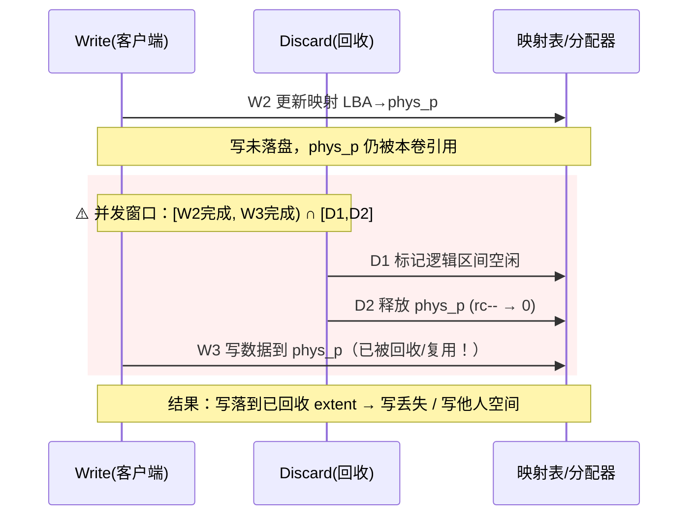
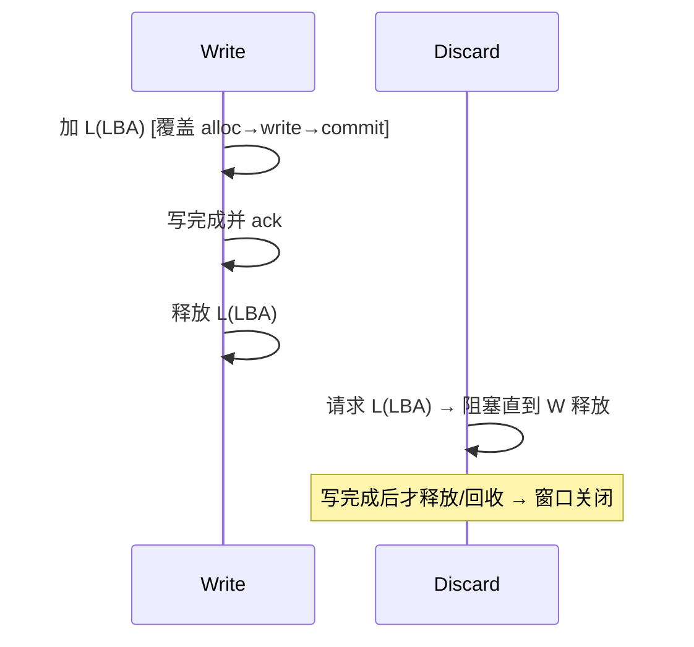
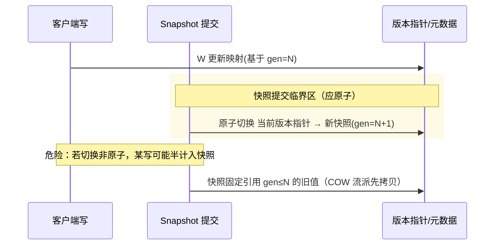
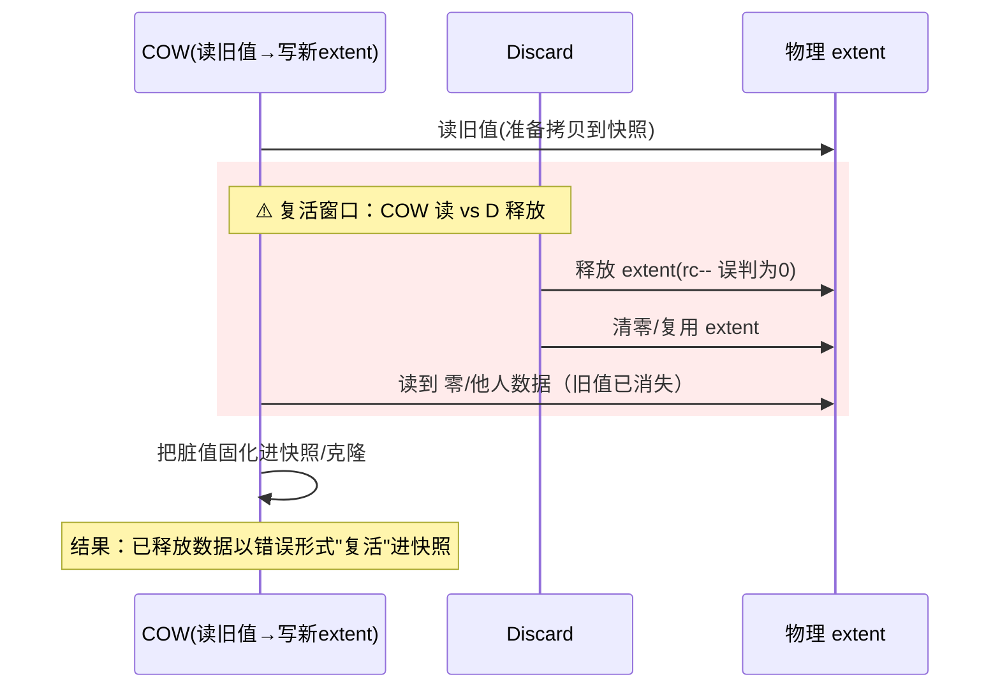
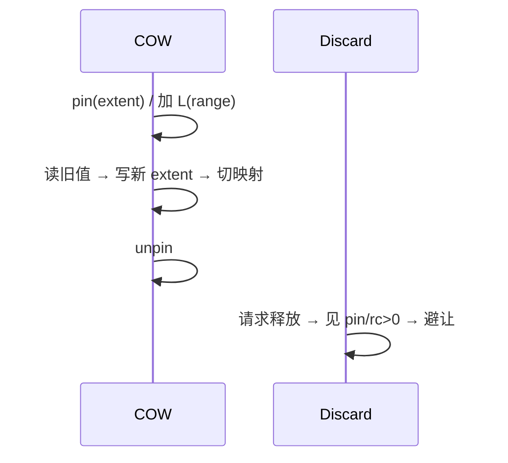
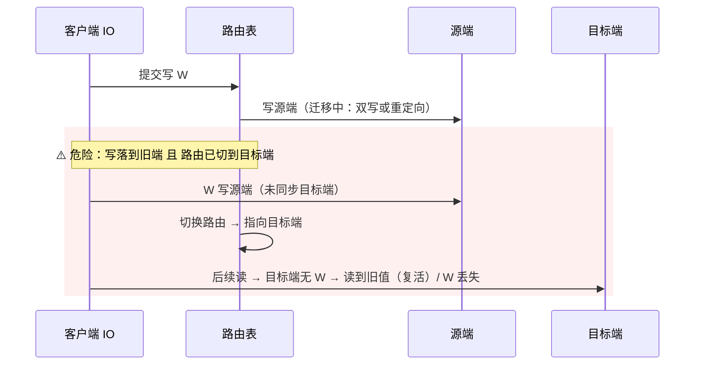
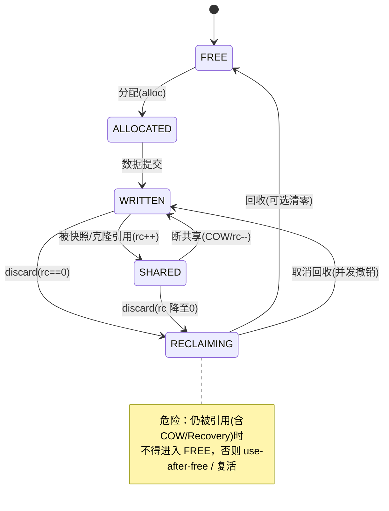

# Mermaid 并发表达模板

用于表达并发场景的**危险交错**与**保护机制**。只在"图能比文字更清楚地说明窗口"时才画。通用约定：

- `sequenceDiagram`：表达两个操作的子步骤交错；用 `Note over` 标注**并发窗口**与**危险点**；用 `rect` 包裹**持锁区间**。
- `stateDiagram-v2`：表达 extent / 卷 / 恢复状态机。
- 颜色仅用 Mermaid 原生（如 `rect rgb(...)`），不要依赖外部样式。

---

## 模板 A：Write / Discard（危险窗口标注）

**保护后**（区间锁关闭窗口）：

---

## 模板 B：Snapshot / Write（快照点一致性）

---

## 模板 C：COW / Discard（数据复活高发区）

**保护后**（COW pin 住 extent）：

---

## 模板 D：Migration / IO（路由不一致）

---

## 模板 E：extent 状态机（通用）

---

## 使用纪律

- 每个时序图必须标出**并发窗口**（哪个子步骤区间重叠）与**危险点**（哪一步导致丢数据/复活）。
- 配一张"保护后"图说明窗口如何被锁/版本/引用关闭。
- 状态机图只画与目标场景相关的状态与迁移，避免堆砌。
- 图中角色名要对应目标系统的真实组件（block / FS / 卷管 / 副本层），不要停留在抽象 W/D。
