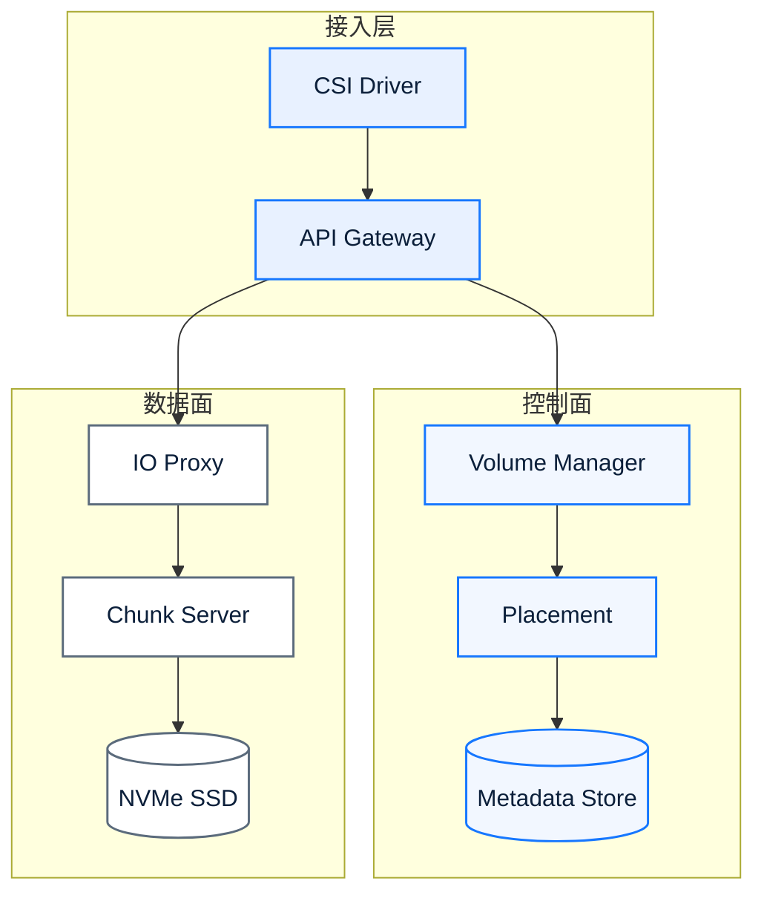
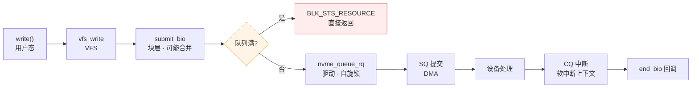
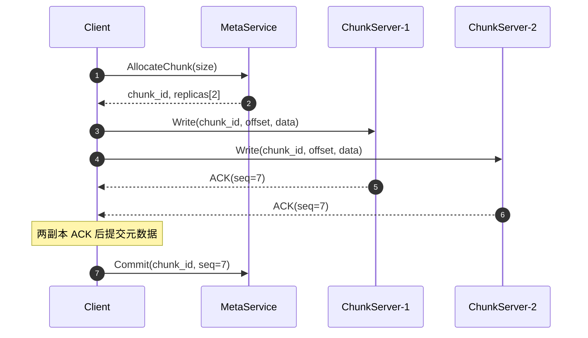
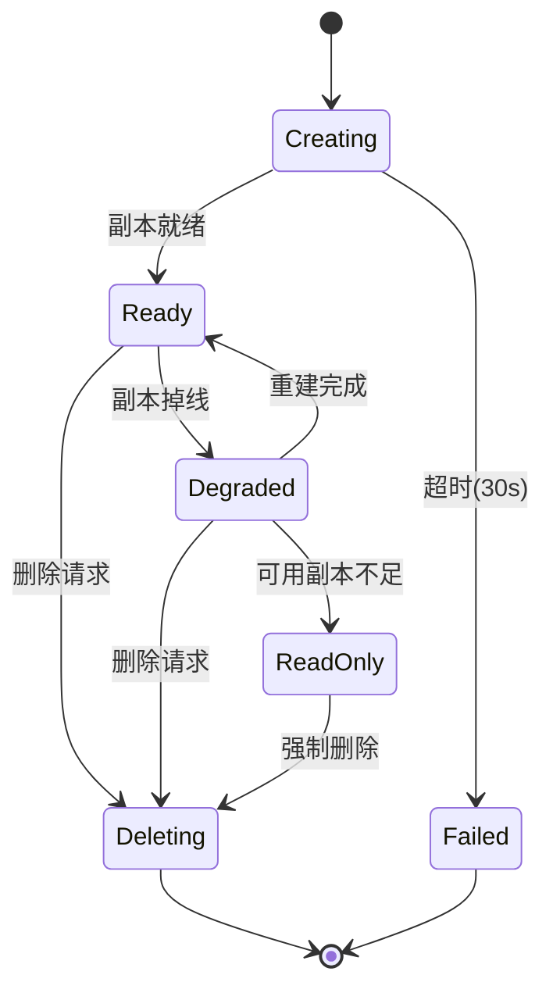
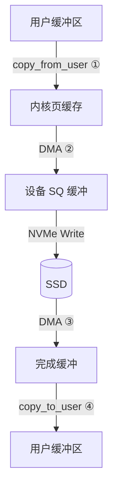

# 封面与插图规范

配套 `producing-tech-blog`。目标是让每张图都能独立解释一个机制，且系列文章的视觉是一致的。

## 一、视觉系统

### 色板（只用这 6 个颜色）

| 用途 | 色值 | 说明 |
|---|---|---|
| 主色 / 强调 | `#1677FF` | 关键路径、主模块边框、重点节点 |
| 深色文字 | `#0B1F3A` | 标题、节点名称 |
| 正文灰 | `#5B6B7C` | 次要说明、辅助文字 |
| 浅底 | `#F2F7FF` | 分组背景、表头 |
| 分隔线 | `#E6EBF2` | 边框、箭头（次要） |
| 白 | `#FFFFFF` | 画布背景 |

禁止：多色渐变、荧光色、立体阴影、卡通图标堆叠。一张图里强调色最多出现 3 次。

### 尺寸

| 类型 | 尺寸 | 备注 |
|---|---|---|
| 封面 | 900×383 或 1536×654（2.35:1） | 公众号首图裁切比例 |
| 正文图 | 宽 1080px（导出 2x） | 公众号正文宽度约 677px，2x 保证清晰 |
| 公众号内宽 | 677px 安全区 | 图内文字不小于 24px（按 1080 稿） |
| 文件格式 | PNG（含文字）/ SVG（可编辑源） | 不用 JPG 存线条图 |

### 图形语言

- 线宽 1.5px（普通）、2.5px（主路径），圆角 6px。
- 节点内文字 ≤ 12 字，超了就拆节点或缩短。
- 箭头必须有语义：实线 = 数据流，虚线 = 控制流/元数据流，粗线 = 关键路径。
- 分层用横向色带或左侧标签，不用盒子套盒子。
- 一张图只表达一个主题；流程超过 8 步就拆成两张。

## 二、9 类图的规范

| 类型 | 用途 | 工具 | 必须标出的信息 | 禁忌 |
|---|---|---|---|---|
| 1 系统架构图 | 组件、分层、边界 | draw.io / Mermaid | 分层、进程边界、外部依赖、故障域 | 把所有内部函数画成模块 |
| 2 模块关系图 | 模块职责与依赖 | draw.io | 依赖方向、接口、共享资源 | 双向箭头糊成一片 |
| 3 数据流图 | 数据在内存/磁盘/网络间的搬运 | Mermaid flowchart | 数据形态、拷贝点、缓冲区 | 只画组件不画数据 |
| 4 时序图 | 多组件交互、异步回调 | PlantUML / Mermaid | 参与者、调用顺序、同步/异步、超时 | 参与者超过 6 个 |
| 5 IO 调用链图 | 一次 IO 从应用到设备 | Mermaid flowchart LR | 每跳函数、上下文、锁、阻塞点 | 跳步、合并多层 |
| 6 状态机图 | 对象生命周期 | Mermaid stateDiagram | 状态、事件、守卫条件、异常迁移 | 漏掉删除/失败分支 |
| 7 原理示意图 | 抽象机制（COW、EC、分层缓存） | draw.io / Excalidraw | 前后对比、关键动作 | 装饰性插画当原理图 |
| 8 性能图表 | 延迟/吞吐/资源曲线 | Matplotlib | 轴标签与单位、基线、测试条件 | 不给基线、截断 Y 轴 |
| 9 封面 / 概念插画 | 传达主题氛围 | AI 生图 | 主体、风格、留白（放标题） | 出现可读文字、真实产品界面 |

## 三、Mermaid 模板

写作阶段可直接在对话中预览；发布前转 SVG/PNG（mermaid.live 或 `mmdc`）。

### 1. 架构图（分层）



### 2. IO 调用链（标锁与阻塞）



### 3. 时序图（含异步与超时）



### 4. 状态机（含异常分支）



### 5. 数据流（标拷贝）



## 四、draw.io 使用规范

1. 画布 1080 宽，网格 10px，开启对齐与等距分布。
2. 字体统一 `Helvetica / 思源黑体`，节点名 14–16px，注释 12px。
3. 分层用横向分区（swimlane），左侧标签写层名（接入层/控制面/数据面）。
4. 导出：`File → Export as → SVG`（保留文本）+ `PNG 2x`（发布用）。
5. 源文件 `.drawio` 与导出的 `.svg` 一起交付，便于后续修改。
6. 复用：把常用节点（Client、SSD、Metadata、Proxy）做成模板页，系列文章保持一致。

## 五、性能图表（Matplotlib）

```python
import matplotlib
matplotlib.use("Agg")
import matplotlib.pyplot as plt

plt.rcParams.update({
    "font.size": 11, "axes.edgecolor": "#5B6B7C", "axes.labelcolor": "#0B1F3A",
    "xtick.color": "#5B6B7C", "ytick.color": "#5B6B7C",
    "axes.spines.top": False, "axes.spines.right": False,
})
fig, ax = plt.subplots(figsize=(7.2, 4.0), dpi=150)
ax.plot(qd, p99_a, marker="o", color="#1677FF", label="方案 A（3 副本）")
ax.plot(qd, p99_b, marker="s", color="#5B6B7C", linestyle="--", label="方案 B（EC 4+2）")
ax.set_xlabel("队列深度")
ax.set_ylabel("P99 延迟 (ms)")
ax.grid(axis="y", color="#E6EBF2", linewidth=0.8)
ax.legend(frameon=False)
fig.tight_layout()
fig.savefig("p99_vs_qd.png", bbox_inches="tight", facecolor="white")
```

硬要求：轴必须有单位；必须给基线（不对比也要给单方案前后）；不截断 Y 轴制造差异；图注写清测试条件（4K 随机写 / 3 节点 / 副本数）。

## 六、封面与概念插画（AI 生图）

### 提示词结构

```
主体：{核心意象，具象化，不要文字}
场景：{数据中心 / 抽象层次结构 / 剖面}
风格：{扁平等距插画 | 极简线稿 | 科技感 3D 微立体}，editorial illustration
配色：深蓝 #0B1F3A + 亮蓝 #1677FF + 白底，克制，无渐变堆叠
构图：{左侧留白放标题 / 中心对称 / 三分法}，负空间充足
画质：clean lines, high detail, 4k
负面：text, letters, watermark, logo, human face, clutter, neon rainbow
```

### 三个可直接改的示例

1. **分布式存储主题**
   `等距视角的三节点存储集群，每个节点是简洁的立方体，节点之间用细亮蓝线连接成三角，数据块沿线路移动；深蓝与亮蓝配色，白色背景，右侧留白；扁平等距插画，editorial style，无文字`

2. **AI 推理 KVCache 主题**
   `剖视的 GPU 与分层存储结构：顶部是计算单元，中间是多层缓存平面，底部是远端存储；数据以发光小块在层间上行；深蓝底 + 亮蓝高光，极简科技插画，中心构图，无文字`

3. **源码/调用链主题**
   `抽象的函数调用链：一条主线上串联若干几何节点，一条分叉代表异步路径；极简线稿风格，深蓝线条 + 亮蓝强调，大量留白，左上留白放标题，无文字无代码`

### 封面检查

- 缩到 200px 宽还能看出主体吗？
- 画面里有没有出现伪文字/伪 UI？有就重生成。
- 与系列前几篇的配色和构图是否同一套？

## 七、图注与正文引用

- 图注格式：`图 N：<一句话说明这张图在讲什么>（<条件/图例说明>）`
- 正文引用图：`如图 3 所示，第二次拷贝发生在…`，不要只写"如下图"。
- 图注独立成立：读者只看图 + 图注也能懂 60%。
- 引用外部图必须标来源与许可；不确定许可就自己重画。

## 八、一致性检查（多图 / 系列文章）

- [ ] 同一组件在所有图里名称一致（不要一会儿 `MetaService` 一会儿"元数据服务"）
- [ ] 同一含义的箭头样式一致
- [ ] 强调色只用在关键路径上
- [ ] 图内字号一致，最小字号在手机上看不清就放大
- [ ] 竖版图高度不超过宽度的 1.6 倍（否则手机上要滑很久）
- [ ] 封面、正文图、结尾图属于同一视觉家族
