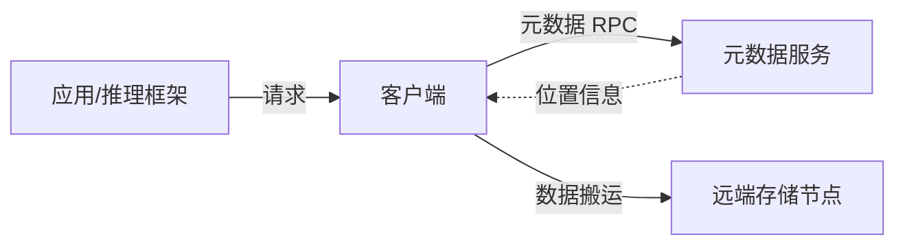
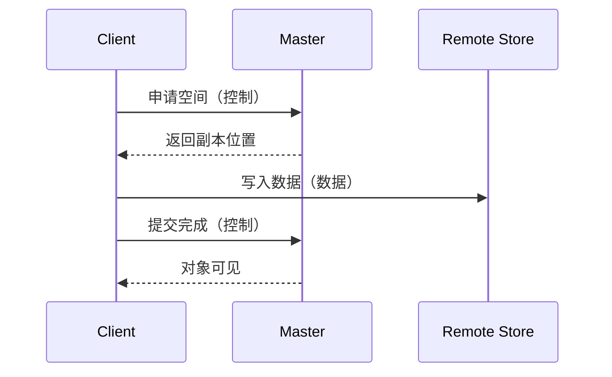

# 图示规范

> 本文件是 `writing-project-principles` 的图示参考。
> 图的用途是回答一个具体问题，不是装饰。默认 Mermaid，每篇通常 2–3 张核心图。

## 一、图类型选型

| 图类型 | 回答的问题 | 适合的主题 | 绘制重点 |
|---|---|---|---|
| 架构图 | 系统由哪些组件构成，职责与部署边界是什么 | 总体架构、控制面/数据面、部署模式 | 分层清晰、角色完整、边界明确 |
| 时序图 | 一次操作跨组件如何协作，谁先谁后 | Put/Get、控制路径、任务生命周期 | 参与者是组件；消息有语义；同步/异步区分 |
| 状态图 | 对象有哪些状态，何时转换 | 生命周期、副本状态、淘汰与恢复 | 状态与迁移条件成对标注 |
| 流程图 | 单组件内部如何判断与分支 | 分配、失败处理、重试、回收 | 判断带条件；正常与异常分支分开 |
| 数据布局图 | 数据在什么位置、如何组织与对齐 | 对象布局、内存段、缓存分层 | 位置与单位明确；概念与实现分开 |

同一机制不要既画流程图又画时序图；二选一，避免重复表达。

## 二、基本规则

1. **一图一问题**：图注直接写出这张图回答的问题。
2. **控制与数据分开**：控制消息、数据搬运、元数据查询用不同箭头或标签区分；不要把三者画成同一种线。
3. **标注数据位置**：关键数据落在 GPU HBM、host DRAM、remote DRAM 还是 SSD，必须在图上或图注写清。
4. **系列语义一致**：组件名、箭头方向、颜色含义在系列内固定；在系列计划中记录图例约定。
5. **不混层**：部署视图、逻辑架构、函数调用层次不画在同一张图里；需要时拆图。
6. **长流程拆图**：参与者过多、连线交叉严重时，按阶段拆成多张图。
7. **主流程与异常分开**：主流程图保持清晰；超时、部分成功、重试、恢复另图说明。
8. **说明图的属性**：图是概念模型还是实际实现，必须在图注或正文说明；不要把示意当成源码事实。
9. **箭头有语义**：箭头表示调用、控制消息还是数据流，要在图注解释。
10. **完成点明确**：时序图或流程图应标出「什么条件算完成」，这是原理文章的关键信息。

## 三、Mermaid 使用约定

- 仓库内默认保存 Mermaid 源码，便于 diff 与再生成。
- 时序图参与者使用领域角色名，不用函数名。
- 架构图节点使用组件名，不用内部类名或字段名。
- 需要精确空间对齐（逐字节布局、内存段偏移）时才退化为 ASCII 或 SVG，并在图注说明原因。
- 用户指定 ASCII、SVG 或其他格式时，遵循用户要求。

### 架构图骨架

图注示例：**图 1：元数据路径与数据路径的分工。** 实线为控制/数据交互，虚线为位置信息返回。

### 时序图骨架

图注示例：**图 2：一次 Put 的控制路径与数据路径。** 标注对象在提交完成前不可见。

骨架只示范格式，不预设任何项目的实际行为；具体参与者和消息必须以所分析版本的源码或官方文档为依据。

## 四、每篇配图预算

- 默认 2–3 张：一张总体关系图，一张核心流程或状态图；需要时再加一张异常或对比图。
- 不为「图文并茂」增加不回答问题的图。
- 同一篇内图注编号连续，正文必须引用每张图。
- 图上的术语与正文、系列术语锚点完全一致。
